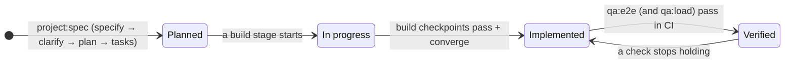
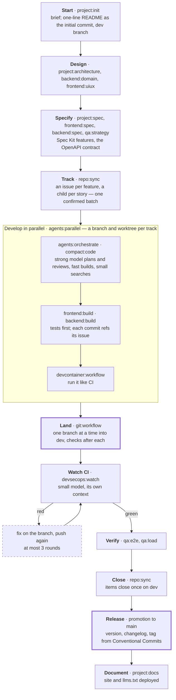

# ai-gent

Skills and plugins for [Claude Code](https://code.claude.com/docs/en/overview) — and, opt-in, [opencode](https://opencode.ai/v2/docs), Codex, Cursor, Gemini CLI, GitHub Copilot, Amp, Kiro and Windsurf — kept in one repository and linked into place, so there's one place to edit.

They cover the whole path of a software project, from idea to docs site, plus the tooling around it:

- **A product pipeline:** brief → architecture → specs → frontend, backend and QA → docs. There are also stages for existing codebases.
- **Container-first development environments.**
- **CI/CD and supply-chain security.**
- **Safe database access**, with passwords kept in [pass](https://www.passwordstore.org/).
- **Issues, work items and pull requests** on GitHub, Azure DevOps, GitLab, Bitbucket and Jira — and the specs mirrored there, kept in step as the work moves.
- **Token-lean code reading**, verified against the original.
- **git rules**, enforced by a hook.

**Why.** It's free and open source (GPL v3+), with no product behind it: the aim is to take the busywork off developers' days and leave them the interesting parts. It's also frugal with tokens by design — one-line skill descriptions (every session loads them), details read only when a task needs them, CI watched by a small model in its own context, and code read in a compact form when it's long.

## Install / update

```bash
curl -fsSL https://raw.githubusercontent.com/lucasvmigotto/ai-gent/HEAD/install.sh | sh
```

That clones the repository into `~/.local/share/ai-gent` and runs `setup.sh`, which asks which agents to install for: an [fzf](https://github.com/junegunn/fzf) selector (a numbered prompt without fzf), with Claude Code and your previous choice preselected. Without a terminal, or with `--skip-prompt`, it installs your previous choice, or Claude Code alone the first time. Run the same command again to update. It fast-forwards the clone, or leaves it alone if you have local changes, and re-links.

Pass `setup.sh` flags after `-s --`, and choose where the clone lives with `AI_GENT_DIR`:

```bash
curl -fsSL https://raw.githubusercontent.com/lucasvmigotto/ai-gent/HEAD/install.sh | sh -s -- --target claude,opencode,codex
curl -fsSL https://raw.githubusercontent.com/lucasvmigotto/ai-gent/HEAD/install.sh | sh -s -- --skip-prompt
curl -fsSL https://raw.githubusercontent.com/lucasvmigotto/ai-gent/HEAD/install.sh | AI_GENT_DIR=~/codes/ai-gent sh
```

| Variable | Default |
| --: | :-- |
| `AI_GENT_DIR` | `${XDG_DATA_HOME:-~/.local/share}/ai-gent` |
| `AI_GENT_REPO` | `https://github.com/lucasvmigotto/ai-gent.git` |
| `AI_GENT_BRANCH` | the repository's default branch; a release tag (`1.2.0`) pins that release |

A pinned clone stays on its tag until you pass another one, or the default branch's name to follow it again. Releases are listed in `CHANGELOG.md`.

When a Claude Code session starts in a checkout with the git plugin installed, a SessionStart hook prints one line if a newer release is known — the check reads a weekly cache and never blocks startup:

```text
[ai-gent] update available: 1.9.0 → 1.10.0 — run scripts/ai-gent-update.sh in the ai-gent checkout (propose first, never self-apply in-session)
```

Pinned checkouts stay silent, and `AI_GENT_NO_UPDATE_CHECK=1` disables the check. An update rewrites the agent's own instructions, so the session that notices it only proposes — applying it (`scripts/ai-gent-update.sh`, then re-running `setup.sh`) takes effect next session. (opencode has no session-start hook point yet, so the notice is Claude-only for now.)

> [!TIP]
> Piping a script into `sh` runs it unseen. To read it first, download, inspect, then run:

> ```bash
> curl -fsSLo install.sh https://raw.githubusercontent.com/lucasvmigotto/ai-gent/HEAD/install.sh
> less install.sh && sh install.sh
> ```

Or clone it yourself:

```bash
git clone https://github.com/lucasvmigotto/ai-gent.git ~/codes/ai-gent
~/codes/ai-gent/setup.sh
```

### `setup.sh`

Re-run it after adding, renaming or removing a skill or plugin, or after changing a plugin skill's description. It's idempotent, and it prunes whatever it installed whose source is gone. Edits to skill bodies need no re-run, since everything points straight at this repository.

> [!NOTE]
> Every agent reads its set of skills (and Claude Code its hooks) when a session starts. After running `setup.sh`, start a new session.

| Flag | Effect |
| --: | :-- |
| `--target <agents>` | which agents to install for, comma-separated, instead of the selector: `claude`, `opencode`, `codex`, `cursor`, `gemini`, `copilot`, `amp`, `kiro`, `windsurf`, or `all` (every agent found on this machine) |
| `--skip-prompt` | no selector: the previous choice, or Claude Code alone the first time |
| `--dry-run` | show what would change |
| `--force` | back up (`<name>.bak-<timestamp>`) and replace a real directory or foreign symlink in the way |
| `--uninstall` | remove everything the script installed, or only for `--target`, including the opencode config edits below |
| `--yes` | apply the opencode config edits without asking |
| `--no-config-edits` | never edit `opencode.json` or a shell profile; print what to add instead |
| `--verbose` | one line per skill and plugin instead of the summary |

Each section ends with a line per status and how many items have it (`[ok] [8/9]`, then `[link] [1/9] compact`, and the reason for any skip); on a terminal the item being processed is shown on a single line as it goes, in color unless `NO_COLOR` is set.

The choice is kept in `${XDG_STATE_HOME:-~/.local/state}/ai-gent/targets`; an install from before the selector that had generated opencode entries keeps opencode chosen. `CLAUDE_SKILLS_DIR`, `OPENCODE_SKILLS_DIR`, `OPENCODE_COMMANDS_DIR`, `AGENTS_SKILLS_DIR`, `KIRO_SKILLS_DIR` and `WINDSURF_SKILLS_DIR` override the target directories. `~/.claude/skills/synced/` is managed by [claude.ai](https://support.claude.com/en/collections/14445694-claude-code) skill sync and is never modified.

**Claude Code.** Each `plugins/<name>/` (and any `skills/<name>/`) is symlinked into `~/.claude/skills/`. A plugin directory there loads as `<name>@skills-dir`, with no marketplace, install step or plugin cache involved. Check a plugin, including its token cost, with `claude plugin details <name>@skills-dir`.

**opencode.** opencode has no plugin namespaces, so for each plugin skill, `setup.sh` generates:
- a `~/.config/opencode/skills/<plugin>-<skill>/SKILL.md` stub, with the real description and an instruction to read and follow the source file in this repository;
- a `/<plugin>-<skill>` command in `~/.config/opencode/commands/`.

opencode V2 also scans `~/.claude/skills`, where plugin skills appear under short, colliding names (`spec`, `build`, …), and it doesn't run Claude Code's guard hooks. So `setup.sh` offers one edit, asked `[Y/n]`, to `~/.config/opencode/opencode.json` (created if absent, a backup kept, a file with comments left alone):

| Edit | What it does |
| --: | :-- |
| the native V2 `permissions` rules | the rules from [Guard hooks](#guard-hooks), with `shell` in place of the legacy `bash`, only the ones you don't already have, appended after yours so they win |
| a `plugins` entry for `opencode/guard` | registers the OpenCode V2 guard plugin, which enforces the same git, db, secrets and repo guards mechanically (opencode runs no Claude hooks) |
| one `skill` deny per plugin skill's short name | hides the colliding IDs opencode finds in `~/.claude/skills`, leaving only the namespaced `<plugin>-<skill>` skills |

The rules are built by `scripts/opencode-config.py`. Your own rules always stay; a rule of yours with the same action and resource is reported and kept. Check the result with `opencode debug config`, and list the active plugins with `opencode plugin list`.

> [!NOTE]
> A config with comments (JSONC) is never rewritten, since that would strip them: `setup.sh` prints the rules to add instead. With no terminal to ask on (a pipe, CI), it edits nothing unless you pass `--yes`, and prints what to add. `--uninstall` removes only what it added. Your own rules always stay; when one of yours has the same pattern, yours is kept and reported.

**Codex, Cursor, Gemini CLI, GitHub Copilot, Amp, Kiro, Windsurf.** These read `SKILL.md` folders but have no plugin namespaces and run no Claude Code hooks. `setup.sh` generates the same `<plugin>-<skill>` entry files as for opencode (real files, not symlinks, which Cursor skips), plus one per personal skill:

| Agent | Directory |
| --: | :-- |
| Codex, Cursor, Gemini CLI, GitHub Copilot, Amp | `~/.agents/skills/`, shared: all five read it, so choosing several installs it once and no skill is listed twice |
| Kiro | `~/.kiro/skills/` |
| Windsurf | `~/.codeium/windsurf/skills/` |

> [!WARNING]
> On these agents the [guard hooks](#guard-hooks) are instructions only, not enforced. Some of them (Cursor, for one) also read `~/.claude/skills`, where plugin skills appear under short names (`spec`, `build`, …) next to the `<plugin>-<skill>` entries; prefer the namespaced ones.

## Usage

Ask for what you want and the matching skill loads: "set up CI for this repo", "model the domain", "why is this record wrong in the database". Or invoke one directly:

| | Claude Code | opencode | other agents |
| --: | :-- | :-- | :-- |
| a plugin skill | `/project:init` | `/project-init` | `project-init`, the agent's own way (`$project-init` in Codex, `/project-init` in Cursor) |
| with arguments | `/qa:load 2000 concurrent users` | `/qa-load 2000 concurrent users` | `qa-load` and the request: "2000 concurrent users" |

> [!TIP]
> Every enabled plugin's skill descriptions cost context in every session, about 6k tokens for all twelve plugins together (`project` alone about 1.3k; `claude plugin details <name>@skills-dir` shows one plugin's cost). Turn off the plugins a project doesn't need, for that project only:
>
> ```bash
> claude plugin disable devsecops@skills-dir --scope project   # writes .claude/settings.json
> claude plugin disable qa@skills-dir --scope local            # .claude/settings.local.json, not committed
> ```

**Models.** Skills run on your session's model, with one exception: `devsecops:watch` runs on the small model (Haiku in Claude Code) in a context of its own, because following CI is triage, and hands any fix back to your session. `agents:orchestrate` routes its work the same way: a strong model plans and reviews, a fast one builds, a small one searches. Both use one table, `shared/agent-roles.md`, which also says how each other agent gets the same: opencode commands as subtasks (`setup.sh` writes them, on `AI_GENT_OPENCODE_MODEL_SMALL` when you set it), and custom agents or subagents in Codex, Cursor, Gemini CLI, Copilot and Kiro.

## Contents

**Product pipeline**

- `plugins/project/`
  - `init` — idea or references → product brief with the shared glossary
  - `architecture` — drivers and usage volumes → capacity model, topology, hosting, API style, data stores, stack, ADRs
  - `spec` — brief + architecture → Spec Kit constitution, features, plans, tasks and the contract skeleton
  - `status` — where the pipeline stands (artifacts, feature statuses, gaps, contradictions) and the next stage to run
  - `docs` — static documentation site in `docs/site/`, plus `llms.txt` and Markdown pages for LLMs
  - `survey` — first contact with a repository: stack, layout, history, how the main branches drift, red flags, and what to run next
  - `recap` — back to a project: where the last Claude Code or OpenCode session left off, what changed since (you, the remote, others), the next step
  - `pitch` — the project's presentation page (short, medium or large; non-tech, basic-tech or tech team) as a Claude Artifact, a ChatGPT Canvas or a static page, every number sourced
  - `introspec` — reverse-engineer an existing codebase into the full pipeline spec, every claim Observed, Inferred or Assumed
  - `retrofit` — upgrade in place with behavior frozen: `patch` (CVEs), `minor` (adapt code), `major` (breaking upgrades)
  - `refactor` — redesign keeping the core invariants; business changes recorded for approval; incremental migration
- `plugins/frontend/`
  - `uiux` — layout and language vision
  - `spec` — design system and per-feature UI specs in Spec Kit format
  - `build` — implement the web frontend phase by phase
  - `tui` — terminal interfaces, only when you ask for one: a TUI and the CLI under it, or a CLI alone. Stacks: Go/Bubble Tea, Rust/Ratatui, Python/Textual, Java/Lanterna, TypeScript/Ink, or .NET/Spectre.Console or Terminal.Gui
- `plugins/backend/`
  - `domain` — domain model: contexts, aggregates, invariants, lifecycles
  - `spec` — canonical OpenAPI contract and per-feature backend specs
  - `build` — implement the backend, tests and contract first
- `plugins/qa/`
  - `strategy` — risk-based test strategy, per-feature traceability and gates
  - `e2e` — cross-stack journeys (Playwright; terminal journeys for a TUI or CLI); sets features Verified
  - `load` — k6 load, stress, spike, soak and breakpoint tests from the capacity model
  - `review` — audit an existing test suite (mutation testing, flakiness, gaps)

**Environment and delivery**

- `plugins/devcontainer/` — container-first development (see [Containers](#containers))
  - `setup` — per-module multi-stage Containerfiles with a thin `tools` layer that agents and CI run, task recipes and resource limits, plus devcontainers for people (API and client apart by default)
  - `infra` — simulate databases, queues, storage, SMTP/mail, OAuth2/OIDC/LDAP and more
  - `proxy` — simulate the production reverse proxy
  - `workflow` — run tasks through the tools recipes, or operate the devcontainer day to day
- `plugins/devsecops/` — GitHub Actions by default; GitLab CI, Azure Pipelines, Bitbucket Pipelines, Jenkins, Forgejo/Gitea
  - `pipeline` — design and create CI/CD pipelines, gates, environments and promotion
  - `supply-chain` — pinning, updates, SCA/SAST/secret scanning, hardened images, SBOM, signing, provenance
  - `iac` — infrastructure as code (OpenTofu/Terraform by default) for the environments the architecture chose
  - `audit` — security and reliability review of existing pipelines
  - `migrate` — move pipelines between platforms
  - `watch` — follow CI/CD runs to the end, explain failures from their logs, and check secrets (names only), variables, environments and permissions; runs on a small model in its own context (Haiku in Claude Code) and hands any fix back
- `plugins/db/` — safe database access for PostgreSQL, MySQL/MariaDB, SQL Server, Oracle and SQLite (see [Databases](#databases))
  - `connect` — list, test and classify connection profiles, never showing credentials
  - `inspect` — full discovery of a database: schema, constraints, indexes, routines, links, statistics, ERD
  - `review` — how the project uses its database: mappings vs. schema, migrations, indexes, queries, pooling, rights, backups
  - `investigate` — a scenario and a symptom → hypotheses, evidence, root cause (hand edit vs. application bug), repair
- `plugins/repo/` — issues, work items and pull requests on GitHub, Azure DevOps, GitLab, Bitbucket and Jira (see [Platforms and secrets](#platforms-and-secrets))
  - `issues` — find, read, create and update issues and work items (Azure Boards WIQL, Jira JQL and transitions), every change asked first
  - `pr` — pull and merge requests: read them with checks, diffs and review threads; open one with the template and linked issues; comment, approve, merge
  - `sync` — mirror Spec Kit features into the tracker (an item per feature, a child item per user story with its tasks as a checklist) and keep their states in step with `tasks.md` and `specs/README.md`, closing at Verified on the integration branch
- `plugins/secrets/` — credentials in [pass](https://www.passwordstore.org/), never shown to the agent (see [Platforms and secrets](#platforms-and-secrets))
  - `pass` — check pass is ready, list entries by name, give the exact `pass insert` for a database password or a platform token under `ai-gent/<area>/<name>`, and move plain-text secrets into pass
- `plugins/agents/`
  - `orchestrate` — run a spec'd feature with role-separated agents: a strong model plans and reviews, a fast model builds, a small one searches; self-contained cards, a worktree per parallel branch, merges asked first, routed for token-efficient use. Agent-agnostic, Claude by default; roles in `shared/agent-roles.md`
  - `parallel` — several features, or a feature's frontend, backend and QA tracks, at once: each on its own branch in a git worktree under `.worktrees/` (kept out of git locally), only where dependencies and file ownership allow, with its own compose project and ports; branches land on `dev` one at a time in dependency order, checks after each, merges asked first
- `plugins/compact/`
  - `code` — read source code token-lean: a verified compact view (no indentation, newlines or optional spaces; strings and comments kept) and an outline with original line numbers. Read-only. In testing, 29–39% fewer tokens than a line-numbered Read
- `plugins/git/`
  - `workflow` — Conventional Commits, branch-per-context naming, the branch chain (work branches → `dev`/`develop` → `homolog`/`staging` → `main`/`master`, promotion to `main` only when asked), merge and cleanup rules, tags, issue linking (see [Guard hooks](#guard-hooks))

## Product pipeline

Each stage writes a file the next one reads, so stages can run in separate sessions or on their own. `shared/pipeline.md` is the contract for paths, ownership, statuses and shared rules.

```mermaid
flowchart LR
    classDef optional stroke-dasharray: 5 5

    init["<b>project:init</b><br/>brief.md with the glossary"]
    arch["<b>project:architecture</b><br/>architecture.md, ADRs, stack"]
    spec["<b>project:spec</b><br/>specify → clarify → plan → tasks<br/>Spec Kit features, specs/README.md,<br/>contracts/openapi.yaml skeleton"]
    init --> arch --> spec

    subgraph frontend ["Frontend"]
        direction TB
        uiux["<b>frontend:uiux</b><br/>ux-vision.md"]
        fspec["<b>frontend:spec</b><br/>design system, ui.md per feature"]
        fbuild["<b>frontend:build</b><br/>web client — implement + converge"]
        tui["<b>frontend:tui</b> — only if you ask<br/>tui.md → TUI and CLI"]:::optional
        uiux --> fspec --> fbuild
        fspec -.-> tui
    end

    subgraph backend ["Backend"]
        direction TB
        domain["<b>backend:domain</b><br/>domain-model.md"]
        bspec["<b>backend:spec</b><br/>canonical openapi.yaml, backend.md"]
        bbuild["<b>backend:build</b><br/>API, migrations, contract tests<br/>— implement + converge"]
        domain --> bspec --> bbuild
    end

    strategy["<b>qa:strategy</b><br/>test-strategy.md, qa.md per feature"]
    e2e["<b>qa:e2e and qa:load</b><br/>journeys and load tests → Verified"]
    docs["<b>project:docs</b><br/>docs/site, llms.txt"]

    spec --> frontend & backend & strategy
    frontend <-. the contract .-> backend
    frontend & backend & strategy --> e2e --> docs

    subgraph existing ["Existing codebase"]
        direction TB
        survey["<b>project:survey</b><br/>first contact: stack, history, branches"]
        introspec["<b>project:introspec</b><br/>the spec, rebuilt from the code with evidence"]
        retrofit["<b>project:retrofit</b><br/>upgrades with behavior frozen:<br/>patch, minor, major"]
        refactor["<b>project:refactor</b><br/>redesign, business change records,<br/>incremental migration"]
        survey --> introspec
        introspec --> retrofit
        introspec --> refactor
    end
    existing -. refactor, in review mode .-> arch

    subgraph anytime ["Alongside any stage"]
        direction TB
        status["<b>project:status</b><br/>where things stand, what's next"]
        recap["<b>project:recap</b><br/>back after a pause: last session, what changed"]
        devcontainer["<b>devcontainer:*</b><br/>containers, simulated infra"]
        devsecops["<b>devsecops:*</b><br/>CI/CD, supply chain, IaC"]
        db["<b>db:*</b><br/>inspect, review, investigate"]
        git["<b>git:workflow</b><br/>branches, commits, merges"]
    end
```



In plain text: init → architecture → spec → frontend, backend and QA in parallel (each build stage is the `implement` step, converged before Implemented) → e2e and load → docs. For an existing codebase: survey → introspec → retrofit or refactor. Returning to any project: recap.

Every feature's status, per side, in `specs/README.md`:



- Documents (brief, architecture, UX vision, domain model) stay `Draft` until you accept them.
- Frontend and backend meet only at `contracts/openapi.yaml` and the brief's glossary.
- Specs use GitHub Spec Kit (`specify` CLI 1.x), set up by `project:spec`. Every feature goes through **specify → clarify → plan → tasks → implement**: `project:spec` runs the first four, `frontend:build` and `backend:build` are the `implement` step (each against its own `## Frontend` / `## Backend` tasks), closing with `/speckit-converge` before a feature is Implemented.

> [!NOTE]
> `frontend:tui` and every terminal section of the vision and specs appear only when you ask for a terminal interface. No stage adds one on its own.

### The autonomous flow

Given permission up front ("build it end to end, you can push"), the whole loop runs on its own: issues, parallel development, CI watching and fixes, closing, versioning, release and docs. Promotion to `main` and releasing still ask unless that permission names them. The same flow, with every skill linked, is on the [docs site](https://docs.lucasvmigotto.me/ai-gent/#/use/flow).



Alongside every step: `secrets:pass` (tokens and passwords never shown), `db:*` (one audited runner), `devcontainer:*`, `devsecops:*`, `repo:issues` and `repo:pr`, `project:status` and `project:recap`, and the guard hooks. Thick borders ask you (unless your up-front permission covers them).

## Containers

The rules are in `shared/containers.md` and are shared by the devcontainer, devsecops and project plugins.

- **Engines:** Podman first, Docker as fallback, never hardcoded.
- **The `tools` stage** of each module's Containerfile is where agents and CI run every task, through the same recipes (`just test`). The devcontainer for people can be heavier, but it reads its toolchain versions from the same single source.
- **Images:**
  - Docker Hardened Images (`dhi.io`), pinned by digest;
  - multi-stage builds that mount sources and caches instead of copying them;
  - a deny-by-default `.dockerignore`;
  - resource limits on every container.
- Pushes to `ghcr.io` use the workflow's own token, logged in as the repository owner.

> [!IMPORTANT]
> CI needs a `DOCKER_HUB_PAT` secret to pull hardened images from `dhi.io`. Its username comes from the `DOCKER_HUB_USERNAME` variable, which defaults to the repository owner. Locally, log in once with `podman login dhi.io` (or `docker login dhi.io`).

## Databases

Every `db:*` skill reaches a database only through `plugins/db/scripts/dbrun.py`, which enforces `plugins/db/references/safety.md`.

- **Remote databases** are production, staging/homologação, shared development, or anything not proven local. They get `SELECT` only, with timeouts, row caps and cost guards.
- **Local databases** are only this repository's own database containers, running on this machine and reached through the container's own network.
  - A write needs a recorded plan, your confirmation and a backup, and can be restored.
- **Results are masked by default** (names, emails, CPF/CNPJ, phones, cards, secrets) and revealed only when you ask.
- **Every statement is logged before it runs**, outside the repository.

> [!IMPORTANT]
> `dbrun` never executes a write on a remote database, in any environment. A change to one is written as a script, for a person to review and run.

> [!CAUTION]
> A local container restored from a production or staging dump is writable, but its rows are still real personal data. Masking and the logging rules apply exactly as for the source.

Connection profiles live in `~/.config/ai-gent/db/`, mode 600: `connections.toml` (profiles grouped in families that share an account and its password) and/or `connections.env`, format in `plugins/db/references/connections.md`. They hold no passwords by default: `dbrun` reads each one from pass (`ai-gent/db/<family>` or `<profile>`, or `pass:<entry>`), and a plain-text password is the last resort, flagged by `dbrun profiles` and moved into pass by `dbrun secrets migrate <PROFILE>` or `--all`. Oracle profiles take a service name or a SID. A running database container of the current project is discovered automatically as `local:<service>`.

## Platforms and secrets

Credentials live in [pass](https://www.passwordstore.org/), the standard Unix password manager, under `ai-gent/<area>/<name>` (`AI_GENT_PASS_PREFIX` replaces `ai-gent`). The rules are in `shared/secrets.md`, shared by the `secrets` and `db` plugins.

- **pass first, a plain-text file last.** Database passwords come from `ai-gent/db/<profile>`; platform tokens from `ai-gent/github/pat`, `ai-gent/azure-devops/pat`, `ai-gent/gitlab/pat`, `ai-gent/bitbucket/token` and `ai-gent/jira/token`.
- **The agent sees names only.** You add a secret in your own terminal (`pass insert ai-gent/db/shop-dev` prompts without echo); only the runner that needs it (`dbrun`, `reporun`) decrypts it, when it uses it, and redacts it from every message and log.
- **Specs on the tracker.** On request, `repo:sync` mirrors each Spec Kit feature as an item and each user story as a child item, recorded in `specs/NNN-*/tracker.md`. From then on the pipeline keeps them in step (rule 10 in `shared/pipeline.md`): stages sync at their hand-off, story branches and `Refs` footers use the recorded refs, and items close at Verified once the work is on the integration branch (`reporun chain` finds it: `dev`/`develop`, else `main`/`master`). Every sync is one batch, confirmed once.
- **CLI first, REST as the fallback.** `repo:*` skills reach the platforms through `plugins/repo/scripts/reporun.py`: the platform's own CLI (`gh`, `az` with the `azure-devops` extension, `glab`, `jira`) when it's installed, with the token in that process's environment only; its REST API otherwise (always for Bitbucket). Reads run freely; every change (create, comment, transition, approve, merge) needs `--write`, which the `repo` guard turns into a question.
- **The `secrets` guard hook** denies anything that would show a value (`pass show`, `pass -c`, `gpg` on the store, …) and `pass insert` by the agent ([Guard hooks](#guard-hooks)).

## Guard hooks

Four plugins install `PreToolUse` hooks in Claude Code. They enforce their rules mechanically, not just as instructions. They load in a new session after `setup.sh`.

| Hook | Blocks | Asks first |
| --: | :-- | :-- |
| `git` (`plugins/git/hooks/guard.sh`) | `--no-verify`, `Co-Authored-By` trailers, `push --force` without a lease | pushes; commits or merges on `main`/`master` or `homolog`/`staging`; commits on `dev`/`develop` (merges into it pass); `branch -D`, `reset --hard`, `clean -f`, `commit --amend`, history rewrites, `gh pr create` |
| `db` (`plugins/db/hooks/guard.sh`) | direct database clients (`psql`, `mysql`, `sqlcmd`, `sqlplus`, `sqlite3`, `mongosh`, …) running SQL that writes; restore tools; any tool or command whose target is a credentials file (text that merely names one is fine) | any other direct client use |
| `secrets` (`plugins/secrets/hooks/guard.sh`) | a `pass` command that shows, copies or searches a value (`show`, a bare `pass <entry>`, `-c`, `-q`, `edit`, `grep`, `generate`, `otp`), `pass insert`, `gpg` on the password store, `pass-run` with an `ai-gent/db/` entry or with a command that prints its environment | `pass rm`, `mv`, `cp`, `init`, `git` |
| `repo` (`plugins/repo/hooks/guard.sh`) | — (`reporun` itself refuses token-printing CLI commands, other hosts and writes without `--write`) | every `reporun … --write`: a change to an issue, work item or pull request |

> [!NOTE]
> opencode doesn't run Claude Code hooks. `setup.sh` offers to add native V2 `permissions` rules **and** an OpenCode V2 guard plugin (`opencode/guard/`) that enforces the same git, db, secrets and repo guards — including `ask` decisions and the current-branch check, which a shell pattern cannot express. A parity test keeps the plugin's rules identical to the shell guards'. The rules are appended after your own, so they win; the last matching rule counts:

> ```jsonc
> "permissions": [
>   { "action": "shell", "resource": "git push*", "effect": "ask" },
>   { "action": "shell", "resource": "git commit*--no-verify*", "effect": "deny" },
>   { "action": "shell", "resource": "git branch -D*", "effect": "ask" },
>   { "action": "shell", "resource": "git reset --hard*", "effect": "ask" },
>   { "action": "shell", "resource": "gh pr create*", "effect": "ask" },
>   { "action": "shell", "resource": "psql*", "effect": "ask" },
>   { "action": "shell", "resource": "mysql*", "effect": "ask" },
>   { "action": "shell", "resource": "sqlcmd*", "effect": "ask" },
>   { "action": "shell", "resource": "sqlplus*", "effect": "ask" },
>   { "action": "shell", "resource": "sqlite3*", "effect": "ask" },
>   { "action": "shell", "resource": "pg_restore*", "effect": "deny" },
>   { "action": "read", "resource": "~/.config/ai-gent/*", "effect": "deny" },
>   { "action": "edit", "resource": "~/.config/ai-gent/*", "effect": "deny" },
>   { "action": "shell", "resource": "pass show*", "effect": "deny" },
>   { "action": "shell", "resource": "pass insert*", "effect": "deny" },
>   { "action": "shell", "resource": "pass edit*", "effect": "deny" },
>   { "action": "shell", "resource": "pass -c*", "effect": "deny" },
>   { "action": "shell", "resource": "*reporun*--write*", "effect": "ask" }
> ]
> ```
> Plus a `plugins` entry for the guard plugin and one `skill` deny per plugin skill's short name.

## Layout

```txt
plugins/<name>/.claude-plugin/plugin.json
plugins/<name>/skills/<skill>/SKILL.md          a plugin skill                    → /<name>:<skill>
plugins/<name>/skills/<skill>/references/       files one skill reads on demand
plugins/<name>/references/                      files a plugin's skills share
plugins/<name>/hooks/                           guard hooks (git, db)
plugins/<name>/skills/<skill>/scripts/          tools one skill runs (compact:code: compact.py)
plugins/<name>/scripts/                         tools a plugin's skills run (db: dbrun; project: sessions, repo_state)
plugins/<name>/evals/                           trigger and behavior evals
skills/<name>/SKILL.md                          personal skills (skill-docs)     → /<name>
shared/                                         pipeline, container and code-reading rules, symlinked into plugins' references/
opencode/guard/                                 the OpenCode V2 guard plugin, its rules and parity test
scripts/                                        check.sh, release.py, opencode-config.py, test-dbrun-engines.py and the tests
.github/workflows/                              check (pull requests), release (pushes to main)
```

## Development

Conventions for editing skills and plugins are in `AGENTS.md` (also available as `CLAUDE.md`).

**Checks.** Run `scripts/check.sh` before committing; CI runs the same script.
- **Metadata:** skill names and description budgets (400 characters, since every session loads them), and plugin manifests.
- **References:** `plugin:skill` references, relative paths and symlinks.
- **Scripts:** shell scripts through shellcheck.
- **Tests:** the git, db, secrets and repo guards, `dbrun` (its statement classifier, masking and SQLite end-to-end paths), `reporun` (remotes, read/write classification, auth headers against a local stub), the project scripts (`sessions.py`, `repo_state.py`), `compact:code` (with a pinned Pygments, `PYGMENTS_VERSION`, fetched through `uv`), the OpenCode guard rules (in parity with the shell guards, run with `bun` or `node`), the release script, and the installers in a throwaway `HOME`.
- **Options:** `--quick` skips the installer tests. Shellcheck runs at a pinned version (`SHELLCHECK_VERSION`) through `uvx` or `pipx`, so a local run and CI agree.

**Database engines.** Before pushing a change to `dbrun`, run `scripts/test-dbrun-engines.py` (`--engine <name>` for one). It tests `dbrun` end to end against real PostgreSQL, MySQL, MariaDB, SQL Server and Oracle containers, one at a time, capped at 2 GB of RAM; the images (about 5.5 GB) are pulled once. It isn't part of CI.

**Evals.** `claude plugin eval plugins/<name> --runs 1 --ablation none` runs a plugin's trigger cases. They check that a request loads the right skill and not its neighbor.

> [!NOTE]
> Eval runs cost real tokens, so they aren't part of CI.

Behavior cases that need a shell also need `--scaffold --allow-tools Bash` and the eval sandbox's dependencies (`bubblewrap`, `socat`).

**Releases are automatic.** Every push to `main` runs the checks. Then `scripts/release.py` decides from the Conventional Commits since the last tag:
- `feat` → minor;
- `fix`, `perf` or `refactor` → patch;
- `!` or `BREAKING CHANGE` → major;
- anything else → no release.

A release:
1. bumps the versions of the plugins that changed;
2. turns `CHANGELOG.md`'s `## Unreleased` into the release entry, or generates one;
3. commits `chore(release): X.Y.Z` and tags `X.Y.Z`;
4. publishes a GitHub Release.

> [!TIP]
> Preview the next release with `python3 scripts/release.py --dry-run`.

> [!IMPORTANT]
> The bot pushes the release commit and tag straight to `main`, so branch protection must let `github-actions[bot]` push. After each release your local branch is one commit behind: run `git pull --ff-only` before new work.

## License

Copyright (C) 2026 lucasvmigotto. Licensed under the GNU General Public License v3.0 or later (`GPL-3.0-or-later`); see `LICENSE`.

Exception: `plugins/frontend/references/visual-direction.md` is adapted from Anthropic's `frontend-design` skill under the Apache License 2.0; see `plugins/frontend/references/LICENSE-frontend-design.txt`.
