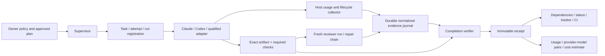

# Architecture supplement and decisions

Status: proposed implementation design, 2026-11-17. Extends the Rust workspace decisions rather than replacing docs/product/architecture.md's older docs-site description. No runtime change is delivered here.

## Domain boundaries

Execution runs a registered scope. Collection observes runtime facts. Review evaluates an exact artifact. Completion verifies policy and publishes a receipt. Reporting reads evidence. Host integration normalizes capabilities. None can substitute its own notion of done for another boundary. Worker terminal status never authorizes tracker completion.

A repository identity survives worktree and machine changes: generated once, persisted in the tracked task policy, distinct from local paths and Git remote names. Forks can retain identity when continuing the same project; intentional independent projects use an explicit rekey migration preserving origin references. Attempts/runs use UUIDv4 (or an equivalent collision-resistant UUID implementation reviewed for platform support), not epoch seconds. Existing per-feature T001 IDs remain unchanged.

## ADR A1 — Local journal before database/service

Decision: repository-scoped framed append journal plus immutable content-addressed receipts, with one logical writer lock. Store private runtime data under the existing git-excluded `.ai-gent/usage/`; export sanitized verification artifacts under tracked `task-evidence/` (new proposed path) only at completion. Reuse the std::fs::File::try_lock pattern already in delegate/events.rs; parameterize the current 15-second timeout to the new 5-second maximum and retain cross-platform crash tests. Do not add a lock dependency for functionality the current MSRV already supplies.

Rationale: no mandatory service, credentials or coupling to dbrun/SQLite. Rebuild projections from immutable evidence. Alternatives: SQLite improves querying/transactions but adds integration/locking/migration decisions; a remote collector improves trust separation but needs deployment/authentication. Revisit only with measured workload or higher-assurance demand.

Acceptance: acknowledge only after append+flush durability, reject interior corruption, isolate incomplete tail, synchronize directory publication where supported, qualify Windows/macOS behavior separately. A lock does not protect against a malicious same-user process.

## ADR A2 — Measurement is multidimensional

Decision: quality, attribution, effective identity verification and attestation are independent. One boolean certified is forbidden. A locally verified receipt means the registered source evidence satisfies recorded rules. A reconciled receipt additionally records matched provider evidence; neither proves that unobserved calls outside registration never happened.

Alternative: call all hash-valid records provider-certified. Rejected because a digest establishes integrity relative to known bytes, not who produced them or whether every request was captured.

## ADR A3 — Hooks collect, executable and CI gate

Decision: optional native hooks supply request/lifecycle observations; supervisor commands own registration, drain and acceptance. A required CI verifier prevents a hand-edited completion marker from being authoritative. Hookless hosts use wrapped command or explicit imports; capabilities determine whether strict complete evidence is possible.

Alternative: block Stop until an agent fills a Markdown token field. Rejected because final usage may arrive later, hooks vary by host, repeated model turns spend more tokens, and prose is not authoritative persistence.

## ADR A4 — Roles and providers are separate

Decision: roles describe work; host describes the application; provider/model describe actual execution; restrictions describe effective tool/OS permissions. A coordinator can be Claude or Codex. A reviewer needs a fresh context and exact artifact; optional diversity policy can require a different model/provider. Same-agent fresh review is valid under standard policy. High-assurance policy may additionally require separately enforced read-only execution, and must reject unsupported hosts.

Alternative: Codex cannot review Codex or Claude alone makes judgments. Rejected by current owner goal and because brand diversity does not prove execution independence.

## ADR A5 — Artifact digest avoids receipt self-reference

Decision: accepted artifact digest is computed from a canonical sorted manifest of covered paths, modes and blob/content digests. Exclude only declared evidence files and generated status projections from artifact payload; include source, tests, contracts and the task definition fingerprint. The exclusion list is policy-versioned and CI-protected. The receipt can then be committed without needing its own future commit ID. Integration attestation binds the receipt to the actual landed commit/tree and checks semantic equivalence of covered content after merge.

A merge conflict changing covered content requires new checks/review/receipt or an explicitly reviewed successor attestation; a new parent commit alone does not invalidate identical payload. Failed attempts and old receipts remain visible. A receipt never authorizes omitting source files from the manifest.

## ADR A6 — Task allocation is explicit

Decision: one task per execution scope is the default for exclusive measurement. Planning across tasks records a shared scope with enumerated beneficiaries, never arbitrary guessed per-task cost. A shared scope is registered before invocation and contributes once globally; allocations are separate, versioned estimates. The completion gate requires a closed declared shared reference but excludes allocations from exclusive measured totals.

Alternative: weight tasks by description length or divide total usage evenly. Allowed only as explicitly heuristic reporting, never exact task certification.

## ADR A7 — Tiers are evidence promises

Decision: Claude + Codex are equal Tier 1 targets for this follow-on program. Tier 2 means tested adapter capabilities; Tier 3 portable skills/CLI best effort. Do not reserve a fixed brand assignment for lower tiers without evidence. OpenCode is the first planned Tier 2 qualification candidate. Existing registry entries remain supported, existing release gates unchanged. See capabilities.md.

## Open implementation risks

Host telemetry may omit final usage, actual model identity or failed-request counters. Local hooks may fail open and native subagents may inherit broader permissions. Filesystem durability differs across OSs. Aliased models and managed providers complicate pricing/reconciliation. These risks cause explicit partial/unqualified states and block only guarantees requiring their missing dimensions; they do not justify fabricated values.

## Dependency implementation detail

The baseline Cargo.lock already contains sha2 0.10.9/0.11.1 and uuid 1.29.2 as transitive packages. 046 proposes direct sha2 0.10.9 and uuid 1.29.2 with OS-random v4 generation, after checking their chosen feature set against the pinned toolchain and cargo-deny policy. Add only those direct requirements/needed features; no blanket dependency update. Revalidate if home development changed the lockfile. Never implement UUID entropy or SHA-256 manually, shell out with sensitive payloads, or claim a transitive lock entry already exposes a core API. This is a planned dependency change, not one made in this branch.
