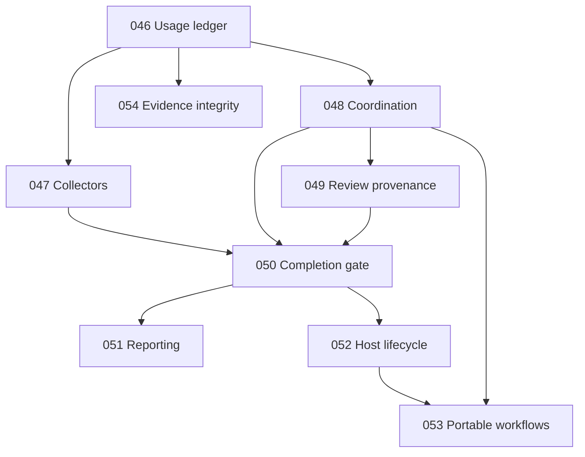

# Implementation roadmap

All features are Planned, with 27 stories, 81 functional requirements and 198 implementation tasks. No estimates of actual token use are invented. Numbering reserves 046–054 from the fetched develop baseline; recheck remote numbering before the first build branch because another agent may add specs.

The authoritative dependency list is program.json; the diagram omits redundant transitive edges. Existing prerequisites: 032 Rust workspace, 033 guards, 034 doctor, 035 token tools, 036 worktree tool, 037 spec/repo consumers and 041 delegation. Reconcile current develop before coding; do not wait for or rewrite unrelated 043/044/045 work.

## Waves and independently shippable slices

| Wave | Feature/slice | Exit and what it unlocks |
|---|---|---|
| 0 | Reconcile branch/audit, adopt contracts, register policy/ownership | Current base pinned, first dependency fix landed or reproduced; no release-gate mutation |
| 1 | 046 US1 identity → US2 semantics → US3 durable journal | Offline registered evidence, crash/replay tests, v1 export; no enforced completion yet |
| 1 independent | 054 lexical outcomes and inventory proof | Honest evidence tools; JSON consumers migrated together |
| 2 | 047 Claude/Codex collectors and generic extension, then OpenCode qualification | Real closure evidence for qualified surfaces; unsupported cells explicit |
| 2 | 048 role routing/admission, ownership DAG, bounded launch | Either Tier 1 coordinator; approved registered dispatch and atomic slots |
| 3 | 049 exact-artifact independent review and repair chain | Fresh-context same/cross-provider review evidence |
| 4 | 050 pending/acceptance gate, consumers, changed-task CI, migration | Minimum trustworthy metered task completion available in observe/warn, then strict |
| 5 | 051 reports and builder/reviewer pair views | Reconciled raw totals, missingness and optional dated cost estimates |
| 5 | 052 guards/trust/doctor, recovery, history/handoff | Host-specific lifecycle guarantees qualified explicitly |
| 6 | 053 instructions/install/evals/profiles/tier amendment | End-to-end product integration, docs and compatibility claims match evidence |

MVP is 046 + qualified Tier 1 collection from 047 + admitted execution 048 + review 049 + 050 acceptance verification. Reporting convenience is later; visibility of pending reasons and evidence quality is part of MVP, not optional polish. 054 can ship independently and does not block measurement MVP.

## File ownership and serialization

| Area | Primary owner | Coordination rule |
|---|---|---|
| New usage domain/journal/schema | 046 | Freeze v1 envelope before 047/050 consume it |
| usage/collectors host modules | 047 | Claude/Codex modules can split after common protocol lands |
| delegate schedule/adapter/admission | 048 | Reconcile 7e92b5c dependency fix first; retain stable track IDs |
| delegate/review.rs and provenance | 049 | Branch after 048; no concurrent rewrite of adapter domain |
| completion and status consumers | 050 | Central verifier first, then delegate/wt/spec/repo consumers in serial commits |
| tokens projections/output | 051 | Coordinate with active 035 port; old JSON compatibility required |
| guard/delegate/watch/doctor/project helpers | 052 | Serialize shared evaluator/CLI changes; retain Rust/sh/OpenCode parity |
| skills/hooks/shared refs/setup/docs | 053 | Propose precise text and await approval before writing, then skill-docs/check.sh |
| source verifier/inventories | 054 | Coordinate sources JSON consumers; no unrelated registry overwrite |
| cli.rs, cmd/mod.rs, Cargo files, check.sh, package allowlist, CHANGELOG, specs index | One landing owner at a time | Reserve before editing; rebase on landed dependency; do not resolve by choosing a whole side |

Parallel branches require separate worktrees and disjoint reservations; logical independence is not permission to edit shared files concurrently. Land one branch at a time through normal review into develop. No direct staging/main promotion, release tagging or gate waiver is authorized by this plan.

## Model/role routing

Each task has Executor builder and Reviewer thinker; these are work roles, not vendor brands. Choose actual model/provider/effort through approved capabilities and record effective execution. Contract/security/durability decisions receive high-reasoning review; mechanical documentation/fixtures may use lower effort. The plan does not start billable agents. A later orchestration run may split only approved independent work and must meter every run.

## Review and delivery gates

For each slice: failing acceptance fixtures → implementation → focused tests → independent exact-artifact review → full scripts/check.sh → Conventional Commit on its feature branch → publish sanitized handoff. Follow Spec Kit converge before claiming Implemented; Verified additionally needs QA exits and live qualification for advertised cells. Native skill/hook changes require the concrete AGENTS.md proposal first. The user has requested planning now; no runtime implementation begins in this branch.

## Risks and mitigations

| Risk | Mitigation / decision owner |
|---|---|
| Home agent changes same Rust modules/feature numbers | Fetch before build; reserve IDs/files in remote handoff; rebase isolated branches |
| Host does not expose final/model usage | Retain partial/unqualified; add another qualified source or owner exemption, never invented zero |
| Same-user worker alters local evidence | Declare local integrity boundary; protected/remote collector is optional future assurance work |
| Slow/missing native hooks | Bounded collectors and CLI gate; CI independent of local hook availability |
| Platform flush/lock/rename differs | OS-specific fault tests and support claims; no revoked historical waivers by implication |
| Strict rollout prevents useful work | Preserve artifacts in pending; explicit baseline and owner exemption, distinct metrics |
| Overly broad shared planner allocation | Register shared scope, close it, show allocations as estimates only |
| Pricing/model alias drift | Effective identity and dated price snapshots; unknown cost when unresolved |

## Tracker preparation

Feature/story titles and dependency relationships in program.json are ready for a repo:sync batch. No new issue IDs, board changes or remote comments are created here. Tracker publishing is a separate confirmed batch under repo:sync; specs and remote branch are the current implementation handoff.

## Acyclic completion integration

048 consumes a completion-evidence port but does not build the 050 verifier. Before 050, dependency-free registered execution works and strict dependent readiness remains capability_missing; fixture implementations are not production approval. 054 similarly reports missing verifier as unverified. This avoids a hidden 048↔050 build dependency and preserves the single acceptance authority.
